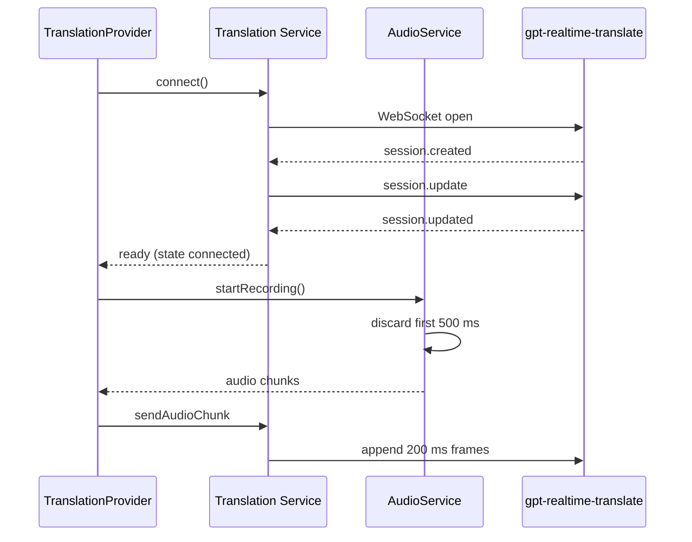

# Requirements

### Overview & Goals
Beim **ersten** Start der Aufnahme beginnt die Übersetzung sofort und liefert komplett unsinnigen Text. Stoppt man nach kurzer Zeit und startet neu, ist die Übersetzung korrekt. Ziel: Der erste Start soll sich genauso verhalten wie jeder weitere – das Modell bekommt erst dann Audio, wenn die Session vollständig konfiguriert ist und das Mikrofon sauberes Signal liefert.

### Befunde der Untersuchung (Code)
(Das 24-kHz-Format, 200-ms-Chunking und die Quelltext-Diagnose sind bereits umgesetzt und nicht Ursache.)

| # | Befund | Stelle | Bewertung |
|---|---|---|---|
| 1 | **Race zwischen Session-Setup und Audio:** `connect()` kehrt sofort zurück und wartet weder auf `session.created` noch auf `session.updated`. `startTranslation()` startet gleichzeitig die Aufnahme. Bei `session.created` wird `state=connected` gesetzt und direkt danach `session.update` gesendet; `sendAudioChunk` sendet aber schon ab `connected` Frames – noch bevor der Server `session.updated` (Zielsprache, Transkription, Noise-Reduction) bestätigt hat. Das Modell arbeitet für die ersten Frames mit Default-Konfiguration. | `openai_realtime_translation_service.dart` Z.97-153, Z.161-165, Z.260-280; `translation_provider.dart` Z.114-123 | **Wahrscheinliche Hauptursache** (beim 2. Start sind TLS/DNS/Mikrofon „warm“, Timing ist anders) |
| 2 | **Mikrofon-Anlaufphase:** Beim ersten `startStream` liefern Plattform-AEC/NS/AGC (`echoCancel`, `noiseSuppress`, `autoGain` alle `true`) in den ersten Hundert Millisekunden Knackser/Rauschen; AGC verstärkt Stille/Grundrauschen. Das Modell halluziniert daraus sofort „Übersetzung“. Alle Samples werden ungefiltert weitergereicht. | `audio_service.dart` Z.109-135 | Wahrscheinliche Mitursache |
| 3 | Die App-UI beschreibt die Quelle als „Mischpult / USB“ (Line-Signal). AGC/Noise-Suppression/AEC sind für ein sauberes Line-Signal unnötig und können es verfälschen; zusätzlich ist serverseitig bereits `noise_reduction: near_field` aktiv (doppelte Rauschunterdrückung). | `audio_service.dart` Z.117-124, `_sendSessionUpdate` Z.237-252, `home_screen.dart` Z.98 | Verstärker |
| 4 | Keine Diagnose, wann Session „ready“ ist und wie laut/was die ersten gesendeten Frames sind; Ursache ist deshalb nicht direkt belegbar. | Service / Provider | Diagnose-Lücke |
| 5 | `startTranslation()` hat keinen Schutz gegen Doppelstart und schließt den Service nicht, wenn `startRecording()` nach erfolgreichem `connect()` fehlschlägt. | `translation_provider.dart` Z.94-130 | Robustheit |

> Hinweis: Die Ursache wurde nicht zur Laufzeit reproduziert; 1 und 2 sind aus dem Code abgeleitete Hypothesen. Die Fixes sind so gewählt, dass sie beide beseitigen, und die neuen Logs erlauben die Bestätigung.

### Scope
**In Scope:** Ready-Handshake (Audio erst nach `session.updated`), Mikrofon-Warm-up (erste ~500 ms verwerfen), schonendere Aufnahme-Konfiguration (kein AGC/NS), Start-Reihenfolge im Provider, Diagnose-Logs, Tests.
**Out of Scope:** WebRTC-Umstieg, Resampling, Voice-Activity-Gating clientseitig, UI-Neugestaltung.

### Functional Requirements
- Es wird kein Mikrofon-Audio an die API gesendet, bevor `session.updated` empfangen wurde (Fallback: Timeout 8 s → mit Warnung nach `session.created` fortfahren bzw. Fehler).
- Die ersten ~500 ms nach `startStream` werden verworfen (weder gesendet noch im Pegel-Indikator).
- Beim Start ist der Puffer des Service leer; Audio, das vor „ready“ aufgenommen wurde, wird nie später nachgesendet.
- Der Statustext zeigt während des Setups „Verbinde mit OpenAI...“ und erst nach Ready „Live Übersetzung aktiv“.
- Logs zeigen Zeit bis `session.created`/`session.updated`, Zeitpunkt des Aufnahmestarts und den RMS-Pegel der ersten gesendeten Frames.

# Technical Design

### Current Implementation
- `openai_realtime_translation_service.dart`: `connect()` (Z.97-153) legt nur den WebSocket an und kehrt zurück. `_handleIncomingMessage` setzt bei `session.created` (Z.161-165) `state=connected` und sendet `session.update`; `session.updated` (Z.167-169) wird nur geloggt. `sendAudioChunk` (Z.260-280) sendet Frames sobald `state==connected`. Es gibt `channelFactory` für Tests.
- `audio_service.dart`: `startRecording()` (Z.109-135) startet `RecordConfig(pcm16bits, 24000, mono, echoCancel, noiseSuppress, autoGain)` und leitet **jeden** Chunk sofort an `audioStream` und `_calculateAudioLevel` weiter.
- `translation_provider.dart`: `startTranslation()` (Z.94-130): `connect()` → sofort `startRecording()` → Stream-Listener ruft `sendAudioChunk`.

### Key Decisions
1. **Ready-Handshake im Service:** `connect()` gibt ein `Future` zurück, das erst nach `session.updated` abgeschlossen wird (Timeout 8 s; bei Timeout nach `session.created` mit Warn-Log fortfahren, bei Verbindungsfehler/`error`-Event `throw`). Neuer Getter `isReady`. `sendAudioChunk` sendet nur, wenn `isReady`; beim Eintritt in „ready“ wird `_pending` geleert. So kann kein Audio vor der bestätigten Konfiguration das Modell erreichen.
2. **Provider-Reihenfolge:** erst `await connect()` (ready), dann `startRecording()`. Der State `connected` wird intern erst bei ready nach außen gemeldet, damit der Status „Live Übersetzung aktiv“ stimmt.
3. **Warm-up im AudioService:** die ersten `warmUpDuration` (500 ms = 24 000 Bytes bei 24 kHz PCM16) nach `startStream` werden verworfen. Umsetzung als kleine, testbare Hilfsklasse `WarmUpGate` (zählt Bytes, schneidet ggf. einen Chunk an der Grenze ab).
4. **Aufnahme-Konfiguration:** `autoGain: false`, `noiseSuppress: false`; `echoCancel` bleibt `true` (Schutz vor Rückkopplung über Lautsprecher). Serverseitig bleibt `noise_reduction: near_field`. Als Konstanten in `AudioService`, damit leicht anpassbar.
5. **Keine clientseitige VAD:** die API hat eigenes Turn-/VAD-Verhalten; wir senden weiter einen kontinuierlichen Stream.

### Proposed Changes
**openai_realtime_translation_service.dart**
```dart
static const Duration _readyTimeout = Duration(seconds: 8);
Completer<void>? _readyCompleter;
bool _isReady = false;
bool get isReady => _isReady;

Future<void> connect({...}) async {
  ...
  _readyCompleter = Completer<void>();
  // channel setup unchanged
  await _readyCompleter!.future.timeout(_readyTimeout, onTimeout: () {
    _log('session.updated not received in 8 s, continuing');
    _markReady();
  });
}

void _markReady() {
  if (_isReady) return;
  _pending.clear();            // never send pre-ready audio
  _isReady = true;
  _setState(TranslationConnectionState.connected);
  _readyCompleter?.complete();
}
```
- `session.created`: nur `session.update` senden und Zeit loggen (State noch `connecting`).
- `session.updated`: `_markReady()`.
- `error` vor ready: `_readyCompleter.completeError(...)`, State `error`.
- `onError`/`onDone` vor ready: Completer mit Fehler abschließen (kein hängendes Future).
- `sendAudioChunk`: Guard `!_isReady` statt `state != connected`; `close()` setzt `_isReady=false`, Completer wird sauber beendet.
- Log-Ausgabe von RMS der ersten 5 gesendeten Frames (`_logFirstFrameLevel`).

**audio_service.dart**
```dart
static const Duration warmUpDuration = Duration(milliseconds: 500);
class WarmUpGate {
  WarmUpGate(int bytesToSkip);
  Uint8List? filter(Uint8List chunk); // null/leer solange Warm-up läuft, danach Rest/Chunk
}
```
- `startRecording()`: neues `WarmUpGate` je Start; Listener leitet Daten erst nach `filter()` an `audioStream`/`_calculateAudioLevel` weiter; `RecordConfig` mit `autoGain: false, noiseSuppress: false, echoCancel: true`; Log beim Start und beim Ende des Warm-ups.

**translation_provider.dart**
- `startTranslation()`: Guard `if (_isTranslating) return;`; `await connect()` (ready) → `await startRecording()` → Listener. Bei Fehler nach `connect()`: `translationService.close()` und `audioService.stopRecording()` im `catch`.
- Statusmeldung nach Ready (kommt automatisch über `connected`-State).

### File Structure
Geändert: `lib/core/network/openai_realtime_translation_service.dart`, `lib/core/audio/audio_service.dart`, `lib/features/translation/translation_provider.dart`; Tests `test/openai_realtime_translation_service_test.dart`, `test/audio_service_test.dart`. Keine neuen Dateien (`WarmUpGate` lebt in `audio_service.dart`).

### Architecture Diagram


### Risks
- `session.updated` wird evtl. nicht immer gesendet → Timeout-Fallback (8 s) verhindert Hängen; Log zeigt dann die Abweichung.
- Start dauert um die Handshake-Zeit länger (typisch < 1 s) und die ersten ~500 ms Sprache nach Tipp auf Start gehen verloren – akzeptabel, im UI-Text ggf. erwähnen.
- Hypothesen nicht zur Laufzeit belegt; falls das Problem bleibt, liefern die neuen Logs (Zeit bis ready, Pegel der ersten Frames, Quelltext-Diagnose-Panel) die Grundlage für den nächsten Schritt (z. B. `echoCancel` ebenfalls abschalten).

# Testing

### Validation Approach
Unit-Tests mit Fake-WebSocket (`channelFactory`) sowie `flutter analyze` und `flutter test`. Echte Mikrofon-/API-Tests können vom Agenten nicht ausgeführt werden.

### Key Scenarios
- `connect()` schließt erst nach `session.updated` ab; bis dahin ist `isReady == false` und `currentState != connected`.
- `sendAudioChunk` vor ready sendet nichts und lässt nichts im Puffer zurück; nach ready werden Frames à 9 600 Bytes gesendet und enthalten kein Vor-Ready-Audio.
- Nach `session.created` wird genau ein `session.update` gesendet, `session.updated` setzt ready.
- `WarmUpGate(24000)`: Chunks mit insgesamt < 24 000 Bytes liefern leer; ein Chunk über der Grenze liefert nur den Rest; danach werden Chunks unverändert durchgereicht.

### Edge Cases
- Kein `session.updated`: Fallback nach Timeout (per `fakeAsync` oder verkürztem Timeout) markiert ready und `connect()` schließt ab.
- `error`-Event oder Stream-Fehler vor ready: `connect()` wirft, kein hängendes Future.
- `close()` während des Wartens auf ready beendet das Future ohne Exception-Leak; erneutes `connect()` startet mit leerem Puffer und `isReady == false`.
- Zweiter Aufruf von `startTranslation()` während eines laufenden Starts wird ignoriert.

### Test Changes
`test/openai_realtime_translation_service_test.dart`: bestehende Tests, die direkt nach `session.created` Audio erwarten, auf `session.updated` umstellen; neue Ready-/Fehler-/Timeout-Tests. `test/audio_service_test.dart`: Tests für `WarmUpGate`.

# Delivery Steps

### * Step 1: Add ready handshake to the translation service
`connect()` completes only after the session is configured (`session.updated`), and no audio is sent before that.

- `OpenAiRealtimeTranslationService`: `_readyCompleter`, `isReady`, `_markReady()`; `session.created` only sends `session.update`; `session.updated` marks ready and emits `connected`.
- 8-s timeout fallback with warning log; `error`/stream error/`onDone` before ready complete the future with an error; `close()` resets ready state and buffer.
- `sendAudioChunk` guards on `isReady` and clears the pending buffer when becoming ready.
- Log time to `session.created` / `session.updated` and RMS of the first 5 sent frames.
- Update/add tests in `test/openai_realtime_translation_service_test.dart` (ready, pre-ready drop, timeout, error before ready).

###   Step 2: Add microphone warm-up discard and gentler record config
The first ~500 ms of microphone audio never reach the API or the level meter, and AGC/noise suppression no longer distort the signal.

- `audio_service.dart`: add `warmUpDuration` and the `WarmUpGate` helper; apply it in the `startRecording()` stream listener before `audioStream` and `_calculateAudioLevel`.
- `RecordConfig`: `autoGain: false`, `noiseSuppress: false`, `echoCancel: true`.
- Log start and end of warm-up.
- Add `WarmUpGate` tests to `test/audio_service_test.dart`.

###   Step 3: Fix start sequence in TranslationProvider and verify
Starting translation always follows connect-ready → record → stream, and failures clean up properly.

- `translation_provider.dart`: guard against double start; `await connect()` (now waits for ready) before `startRecording()`; on failure call `translationService.close()` and `audioService.stopRecording()`.
- Keep status texts consistent (`Verbinde mit OpenAI...` until ready).
- Run `flutter analyze` and `flutter test` and fix any regressions.